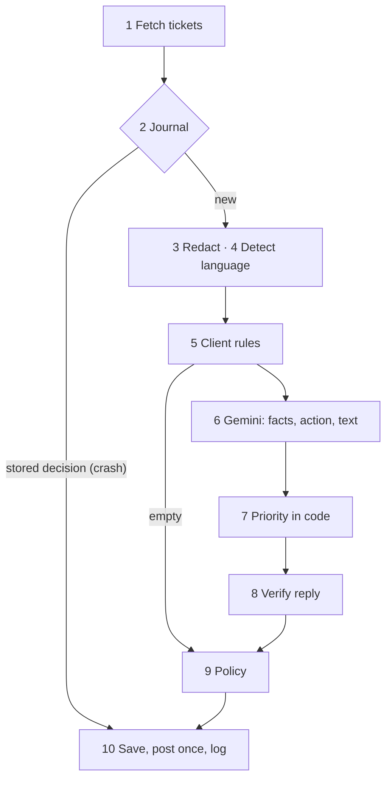

# Roosterly support-ticket agent

A backend-only agent that reads every open ticket from the Roosterly helpdesk (mostly Dutch) and posts exactly one
decision per ticket: a `reply` in the customer's language (facts from [`faq.md`](faq.md) only), a `handoff` with an
English note for a human, or `close` for spam/empty. The LLM recommends; deterministic code decides, posts and logs.

**Documentation map.** This README is the overview; each link goes deeper:

| Read this | For |
|---|---|
| [`ENGINEERING_DECISIONS.md`](ENGINEERING_DECISIONS.md) ([PDF](ENGINEERING_DECISIONS.pdf)) | every decision as a story: problem → options → evidence → decision (30% → 100%) |
| [`backend/eval/RESULTS.md`](backend/eval/RESULTS.md) | every eval run, every error, model comparison, live runs, cost, language eval |
| [`backend/SYSTEM.md`](backend/SYSTEM.md) | architecture, pipeline S0–S8, policy rules, full reliability and security matrix |
| [`backend/API.md`](backend/API.md) | this agent's FastAPI (Swagger at `/docs`): endpoints, examples, step-by-step workflows |
| [`FUTURE_WORK.md`](FUTURE_WORK.md) | roadmap in priority order, each item with a go/no-go acceptance test |
| [`api_reference.md`](api_reference.md) · [`faq.md`](faq.md) | the helpdesk API (Nordavo) · the knowledge base, the only source for replies |

## Status

| | |
|---|---|
| Pipeline S0–S8, CLI, FastAPI | done; dry run by default, posting needs `--live` / `dry_run=false` |
| Model | `gemini-3.5-flash-lite` (local `qwen3.5:2b` evaluated and rejected) |
| Unit tests | **160 passing** (`python -m pytest -q`, no network) |
| Eval (10 labelled `/examples`, final run) | **100%** language, category, priority, action and all four · **0** safety violations · fact accuracy 100% |
| Final live run (30 practice tickets) | 30/30 posted: 11 reply · 17 handoff · 2 close; all client rule checks passed |
| Language eval (no LLM, no cost) | 66/68 correct, 2 unsure (→ human), **0 wrong** · other languages detected and handed off |
| Cost | ≈ **$0.17 (€0.15) per 100 tickets**; whole assignment ≈ $0.25 |

## The problem, and how the agent solves it

**The problem:** Roosterly gets support tickets, mostly in Dutch. Each one needs a language, a category, a priority
(P1–P4) and one action: answer it from the help centre, hand it to a human, or close it. The client's rules are strict:
some topics always go to a human, no customer gets two answers, no payment data leaks, and replies use only
[`faq.md`](faq.md). **So the AI recommends and code decides.** One ticket's journey:

| # | Problem | Tool | What it does |
|---|---|---|---|
| 1 | The helpdesk API fails on purpose (503, 429, 409) | helpdesk client (`requests`) | throttles to 4 calls/s, retries 503, waits on 429, never retries 409 |
| 2 | A crash must not cause a second answer | journal (SQLite) | saves each decision *before* posting; after a crash it replays it, no new model call |
| 3 | Payment data must never leak | redaction | masks card numbers, IBANs and CVCs before the model, logs and replies; flags injection |
| 4 | Which language did the customer write in? | local language detector (`lingua`) | nl / en / de in code, for free; quoted text ignored; other languages or unsure → human |
| 5 | Some topics always need a human | rule engine | refund, cancellation, GDPR, security, legal, threat to leave → forced handoff + minimum priority |
| 6 | Understand the ticket and write the answer | **Gemini** (`gemini-3.5-flash-lite`) | category, action, yes/no facts with evidence, and a reply in the customer's language or an English handoff note |
| 7 | The model misjudged priorities | priority engine (code) | P1–P4 calculated from the facts with the brief's definitions; unclear → P2 + human |
| 8 | How to trust a Dutch reply without reading Dutch | verification engine (Gemini + code) | English back-translation, every claim checked against the help centre, language and links checked |
| 9 | Many signals, one decision | policy | the most careful signal wins: any failed check turns a reply into a handoff |
| 10 | Post once and keep a record | service + logger | posts once, checks the server before any retry, one log line per ticket (no ticket text) |

- **Use it two ways, one pipeline:** the CLI (`python -m app.cli`), or **FastAPI** with a browser page at `/docs`
  (status, look up a ticket, try one, run, eval, fetch, reset). Dry run by default. Guide: [`backend/API.md`](backend/API.md).
- **Measure it:** an eval on Nordavo's 10 labelled examples, plus a free language-only eval. See *Eval and fix*.
- **Full design** (every stage, policy rule and failure case): [`backend/SYSTEM.md`](backend/SYSTEM.md).



## How to run

```bash
cd backend
pip install -r requirements.txt
cp .env.example .env                      # helpdesk key, your email, GEMINI_API_KEY (model: gemini-3.5-flash-lite)
python -m pytest -q                       # 160 unit tests, no network
python fetch_data.py                      # read-only: /examples + tickets -> data/ (needed by eval)
python -m app.cli -v run                  # dry run on open tickets: traces every step, posts nothing
python -m app.cli eval --tag final        # score on the 10 labelled /examples -> eval/results/
python -m app.cli langeval                # language detection only: no LLM, no cost, ~5 s
python -m app.cli reset --yes && python -m app.cli run --live    # final run: one decision per ticket
```
Also: `triage --id T005` or `triage --subject … --body …` (one ticket, dry run), `status`, `models`,
`run --source file` (dry run on the snapshot).

**FastAPI**: everything the CLI does can also be done over HTTP, in the browser. Start it with
`uvicorn app.main:app --reload` (from `backend/`), then open **http://127.0.0.1:8000/docs**. There you can fetch the
data, check the helpdesk status, look up a single ticket (what the helpdesk recorded + exactly what the agent sent),
try a ticket without posting, post one ticket, run all tickets, run the eval and reset the practice tickets.
**Full guide with examples and step-by-step workflows: [`backend/API.md`](backend/API.md).** Everything is a dry run
unless stated:

| Endpoint | Does |
|---|---|
| `GET /health` | config check (no secrets) |
| `GET /status` | helpdesk open/handled + local journal (read-only) |
| `GET /tickets`, `GET /tickets/{id}` | list tickets with their handled state; one ticket = helpdesk record + the decision we stored (reply text, reason, priority) (read-only) |
| `POST /fetch` | read-only snapshot to `backend/data/`, same code as `fetch_data.py` (`app/snapshot.py`) |
| `POST /practice/reset?confirm=true` | re-opens all practice tickets; 400 without `confirm=true`, 409 during a live run |
| `POST /triage`, `POST /triage/{id}` | decide one ticket (by id: posts only with `dry_run=false`) |
| `POST /runs`, `GET /runs/{run_id}` | process all open tickets in the background (posts only with `dry_run=false`; one live run at a time) |
| `POST /eval` | score on the 10 labelled examples |

## Decisions

How each decision was made and measured (model choice, the priority fix, v2–v4, language detection):
[`ENGINEERING_DECISIONS.md`](ENGINEERING_DECISIONS.md) ([PDF](ENGINEERING_DECISIONS.pdf)).

1. **AI recommends, code decides.** Keyword rules (nl/en/de) force a handoff for the client's "always a human" list
   (refund, cancellation, GDPR/AVG, security, legal, threat to leave, card data). The LLM never picks a priority: it
   extracts facts (broken? documented fix? money dispute? cosmetic?) and `priority.py` applies the brief's P1–P4 table.
   A reply is sent only if every check passes (cited FAQ section, verifier, language, no payment data or unknown links).
2. **Dutch: detected in code, written directly, checked in English.** `lingua` detects nl/en/de after removing quoted
   text (UI labels); if unsure, no reply. A second local check over *all* languages catches tickets in another
   language (Spanish, Turkish, Afrikaans, …), which a nl/en/de-only detector would force into nl/en/de: they go to a
   human with the real language in the reason, since the helpdesk only accepts nl/en/de. The model writes Dutch
   directly (no translate-first: one call, no lost nuance, menu names as in the FAQ). A second call back-translates
   each reply and checks every claim against the help centre: that is how I verify Dutch I can't read. Cost: one extra
   call per reply.
3. **Exactly-once, and a small stable model.** A SQLite journal stores each decision *before* posting; after a crash the
   stored decision is replayed. `gemini-3.5-flash-lite`: best and most stable eval score, ~4× fewer output tokens and
   ~5× faster than 3.5-flash; a local 2B model was tried and rejected (30%).

**AI tools:** built with Claude Code (design, code, tests, eval); a second AI assistant reviewed plans (e.g. extracting
facts with evidence). I made and approved the decisions, including the expected facts used in the eval.
**Assumptions:** unsure = any check fails, confidence < 0.70, or unclear facts/language → handoff. Questions the FAQ does
not answer (webhooks, Shopify) and mixed tickets are handed off; "other staff are fine" is impact, not a workaround.

**Considered and not adopted** (evidence in [`ENGINEERING_DECISIONS.md`](ENGINEERING_DECISIONS.md)):

| Option | Why not |
|---|---|
| Local `qwen3.5:2b` (free, private) | 30% all four: mixed up languages, empty FAQ citations, one 27,000-character runaway answer |
| `gemini-3.5-flash` (bigger model) | 70% vs 90% for flash-lite on the same code, results changed between runs, ~4× output tokens, ~5× slower |
| Model picks the priority | 80% priority accuracy; facts + code reached 100% |
| Model labels the language | labelled an English outage `nl`; the local detector is deterministic and free |
| One all-language detector instead of nl/en/de + check | right top pick on all 40 tickets, but scores too low for the 0.70 threshold (Dutch at 0.35): good replies would become handoffs |
| Translate to English first | two extra translation steps, lost nuance and menu names; direct Dutch + back-translation check instead |
| Jev (TypeSafe) as decision engine | built as an experiment (`CLASSIFIER=jev`) but never evaluated (no key); possible later in a limited role, see [`FUTURE_WORK.md`](FUTURE_WORK.md) §2 |

## Reliability

Every behaviour below is checked in the code; the full table with file and line references is in
[`backend/SYSTEM.md` §6](backend/SYSTEM.md).

- **503:** nothing was saved → exponential backoff with jitter (0.5 s doubling to max 8 s, 6 tries in total). Still 503
  → the ticket is marked `failed` and its stored decision is replayed on the next run.
- **429** (the helpdesk allows 5 calls/s): wait `Retry-After` (+ jitter) and retry. The client also throttles itself
  to 4 requests/second, so 429s are rare.
- **409:** the ticket was already handled → recorded as done, **never retried**. A customer never gets two answers.
- **Other 4xx (e.g. 422):** our request is wrong → `failed`, no retry. **Other 5xx / POST timeout** (maybe saved):
  `GET /tickets/{id}` first, re-post only if still open (max 3 attempts per run), otherwise `reconciled`.
- **Crash:** each decision is stored in a SQLite journal *before* posting. Crash before the POST → the next run replays
  the stored decision (no new model call, so the answer cannot change). Crash after the POST → the server shows the
  ticket handled → `reconciled`, no second POST. A practice reset re-opens tickets → old journal rows are archived and
  the tickets are processed fresh.
- **Model down / bad output:** the model client retries network, 429 and 5xx errors (4 tries with backoff); an answer
  that fails the schema gets one corrected retry. Still failing → `deferred`: nothing is posted and the ticket stays
  open for the next run. Output length is capped.
- **Security:** keys only from environment variables / `.env` (git-ignored; `.env.example` in the repo). Ticket text
  is delimited data, never instructions; injection phrases are flagged and can't change the rules, priority or action.
  Card numbers, IBANs and CVCs are masked before the model, in every log and in every outgoing text; a ticket with
  payment data always goes to a human. Logs hold one line per ticket without the ticket body. Models never call the
  helpdesk; only code posts. The API allows one live run at a time and refuses a reset without `confirm=true`.

## Eval and fix

10 labelled `/examples` (Nordavo's labels; the model never writes labels). Every run, error and report file:
[`backend/eval/RESULTS.md`](backend/eval/RESULTS.md).

| | model / method | language | category | priority | action | all four | safety violations |
|---|---|---|---|---|---|---|---|
| before | gemini-3-flash-preview, model picks priority | 100% | 100% | 80% | 100% | 80% | 0 |
| **after** | gemini-3.5-flash-lite, priority calculated (final) | 100% | 100% | **100%** | 100% | **100%** | **0** |
| (rejected) | qwen3.5:2b local | 90% | 90% | 50% | 40% | 30% | 0 |

**The fix:** the model misjudged priority (E01 iOS crash: P2 instead of P3; E02 VAT change: P3 instead of P4). Now it
only extracts facts with evidence and code calculates P1–P4; unclear → more severe + handoff. Priority 80% → 100%, fact
accuracy 100%. Later fixes from the first live run: language in code, `cosmetic_only` → P4, and "workaround" split into
verifiable facts after it caused a regression. Final live run vs the first: 3 tickets changed, all as intended.

**What we observed, and what we did about it** (run by run; all-four accuracy, 0 safety violations in every run):

| # | Run | What we observed | What we decided and did | All four |
|---|---|---|---|---|
| 1 | `before`, local qwen3.5:2b | wrong languages, empty FAQ citations, runaway output, priority 50% | reject the local model, move to a cloud model | 30% |
| 2 | `before-gemini`, gemini-3-flash-preview | the only errors were priorities (E01 P2→P3, E02 P3→P4); preview model | find a stable model; stop asking the model for a priority | 80% |
| 3 | `after`, gemini-3.5-flash-lite, facts → code | priority 100%, fact accuracy 100%; E10 "maintenance planned?" labelled `bug` | keep facts → code | 90% |
| 4 | same code, gemini-3.5-flash | 3 correct replies blocked by the verifier, unstable between runs, ~4× tokens | choose flash-lite | 70% |
| 5 | `v2` | `bug` without anything broken; a correct reply blocked because the verifier saw only one FAQ section; mixed "u"/"je" | `bug` needs something broken; verifier sees the whole FAQ; tone rules; output cap | 90% |
| 6 | live run 1 (v2 code) | English outage labelled `nl`; quoted German button → `de`; a typo got P3 | **v3:** language detected in code (`lingua`); `cosmetic_only` → P4 | (live run, no labels) |
| 7 | `v3` → `v4` | v3 regression: E01 "no workaround" in every run (90%) | **v4:** split "workaround" into three verifiable facts | 90% → **100%** |
| 8 | `final` (v4 rerun) + live run 2 | 100% again; live: 30/30 posted, 3 tickets changed, all intended | ship v4 | **100%** |
| 9 | after the final run | nl/en/de-only detector called Spanish `en` 0.83, Turkish `de` 0.85 | all-language check → human; free `langeval` (66/68, 0 wrong); API eval confirmed 100% | **100%** |

**Language eval (free, no LLM):** `langeval` scores the detector alone on the 10 examples, the 30 practice tickets and
28 hand-written cases (tricky, short, 11 other languages): **66/68 correct, 2 unsure (→ human), 0 wrong**. All 40 real
tickets are detected exactly as in the final run. Details: [`RESULTS.md` §10](backend/eval/RESULTS.md).

**Cost per 100 tickets** (final live run, $0.30 / $2.50 per 1M tokens in/out): 275,303 × $0.30/1M + 33,426 × $2.50/1M
= $0.083 + $0.084 = **$0.17 (≈ €0.15)**. Whole assignment ≈ $0.25, well under the €1 budget.

## What I would improve

**Next step:** more labelled tickets, and a stricter check that a cited "fix" section really describes the customer's
cause (the model once cited the status page as a fix for an outage). **One change to the client rules:** "threat to
leave" is vague and would hand off most annoyed customers; I would ask for a concrete definition (e.g. "explicitly says
they will cancel") so useful replies are not escalated without need.

**Roadmap:** [`FUTURE_WORK.md`](FUTURE_WORK.md) lists the next steps in priority order (more labelled tickets, a calibrated
"unsure" signal with Jev in a limited role, a stricter "fix" check, …), each with the evidence behind it and a go/no-go
acceptance test: it ships only if the eval stays at 100% with 0 safety violations.
