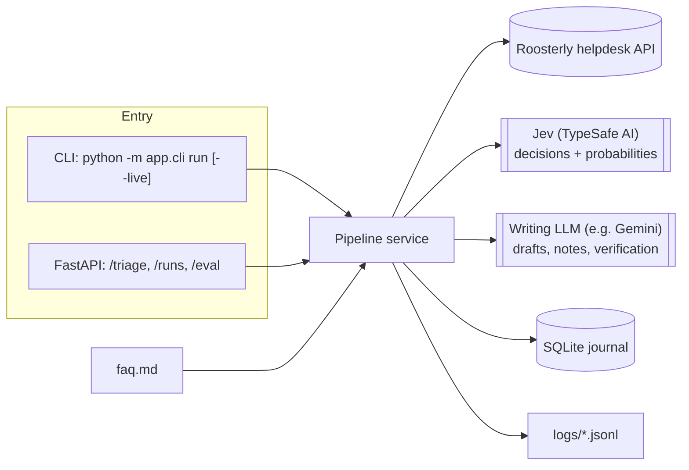
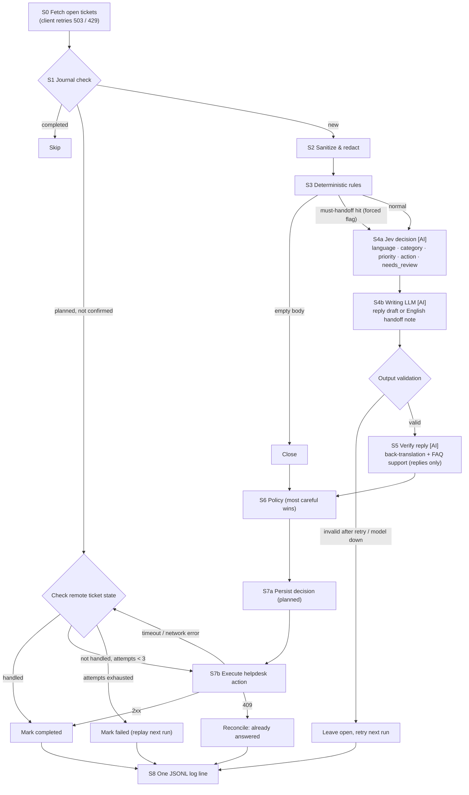

# SYSTEM.md: how the Roosterly ticket agent works

Status: **Final design.** Built and tested: S0–S3, S5–S8, CLI, FastAPI, eval runner.
Next: S4a (Jev) and S4b (writing LLM). See §10 for the build status.

Legend: **[CODE]** = deterministic Python, same input → same output. **[AI]** = model call, needs checking.

---

## 1. The goal

Roosterly (a shift-planning SaaS) already has a helpdesk, a help centre (`faq.md`) and 3 support staff.
We add an AI layer: for every open ticket it decides **language, category, priority + reason, and one action**,
then posts that decision back to the helpdesk **exactly once**:

- `reply`: a draft in the customer's language (nl/en/de), using **only** facts from `faq.md`
- `handoff`: an English note so a human can act in under a minute
- `close`: spam or empty

| Priority | Definition |
|---|---|
| P1 | Many users blocked right now, or a security or legal risk |
| P2 | One customer blocked, or money or the contract is involved |
| P3 | Something is wrong or unclear, but there is a workaround |
| P4 | No urgency: how-to questions, ideas, cosmetic issues |

Judged on: **safe → useful → robust → measured → explained.** Unsure → handoff is fine; handing off everything is not.

**Core principle:** AI *recommends*, code *decides*. The models never call the helpdesk. Deterministic code can only
make the outcome more careful (force handoff/close, raise priority), never less.

---

## 2. The big picture



Both entry points call **the same pipeline service**; the FastAPI routes contain no logic.
"One command" = the CLI. Both are **dry-run by default**; posting needs `--live` / `dry_run=false`.

---

## 3. The pipeline (one ticket)



| Step | Type | Module | What happens | Output |
|---|---|---|---|---|
| **S0 Fetch** | CODE | `clients/helpdesk.py` | `GET /tickets?status=open`, follow `next_cursor`; throttle to 4 req/s; 503 → backoff retry; 429 → wait `Retry-After` | `Ticket[]` |
| **S1 Journal** | CODE | `store/journal.py` | completed → skip; planned/failed → **replay the stored decision** (no new AI call); new → continue | |
| **S2 Sanitize** | CODE | `pipeline/redact.py` | mask card (13–19 digits), IBAN, CVC, expiry → `[CARD]`…; flag injection phrases (nl/en/de) | masked text, flags |
| **S3 Rules** | CODE | `pipeline/rules.py` | client's "always human" list in nl/en/de: refund/disputed charge, cancellation/contract, GDPR/AVG, security, legal, threat to leave, payment data in ticket → forced handoff + priority floor. Empty → close | `forced_action`, `min_priority`, `hits` |
| **S4a Decide** | **AI (Jev)** | `pipeline/jev_classifier.py` | one `system_one` call with 5 questions (§4) on the **masked** ticket | choices + probabilities |
| **S4b Write** | **AI (LLM)** | `pipeline/classifier.py` + `prompts.py` | reply draft (customer's language, cites FAQ ids) **or** English handoff note; spam/empty need no text | `draft_reply` / `handoff_note`, `faq_ids` |
| **S5 Verify** | **AI + CODE** | `classifier.verify`, `policy.py` | replies only: English back-translation, unsupported claims, violations, language check; code: no payment data, links only from the FAQ | `Verification` |
| **S6 Policy** | CODE | `pipeline/policy.py` | merge S3 + S4 + S5 (§5) | final `Decision` |
| **S7 Act** | CODE | `pipeline/service.py` + `store/journal.py` | persist `planned` → POST → `completed`; 409 = done; ambiguous failure → check server before any retry | |
| **S8 Log** | CODE | `core/logging.py` | 1 JSONL line: decision, probabilities, rule hits, flags, verifier result, models, tokens, latency. **No ticket body, no draft, no payment data** | log line |

---

## 4. The AI components

### S4a Jev: the decision engine (TypeSafe AI, `typesafe-sdk`)

Jev answers typed questions about a "state" (the masked ticket) and returns **a probability per option**:
a real confidence signal instead of a model rating itself. Verified against the SDK source (v0.7.5):
`client.system_one(state, questions)` → `response.choices[name].choice / .confidence / .probabilities`,
`response.nouls[name].noul` (P(yes)), `response.usage`.

| Question | Jev type | Options |
|---|---|---|
| `language` | Choice | `nl`, `en`, `de` (the helpdesk accepts only these) |
| `category` | Choice | `bug`, `billing`, `feature_request`, `question`, `other` |
| `priority` | Choice | `P1`–`P4`, with the definitions above as criteria |
| `action` | Choice | `reply` (help centre fully answers it), `handoff`, `close` (spam/empty only) |
| `needs_review` | Noul | "a human should look at this" (yes/no probability) |

The ticket goes in as **state (data)**; our instructions live only in the question definitions.
The SDK debug log prints request bodies, so it stays at the default level, and only masked text is ever sent.

### S4b Writing LLM: drafts and notes (provider TBD, e.g. Gemini)
Called **after** Jev, with Jev's decision as input:
- `action = reply` → draft in the ticket language using only the help-centre text; must return `faq_ids`.
- `action = handoff` → English note (what the customer wants, key facts, rule hit, suggested next step).
- `action = close` → no call (saves cost).

### S5 Verify (same writing LLM, separate call)
For replies only: a literal **English back-translation** (stored in eval reports so a non-Dutch reader can check every
reply) plus a claim-by-claim check against the cited FAQ sections. This is how we check Dutch without reading Dutch.

### Why this split
| | Jev | Writing LLM |
|---|---|---|
| Job | pick labels | write and check text |
| Strength | calibrated probabilities, cheap, fast | fluent Dutch/German, follows the FAQ |
| Weakness | can't write text; non-English accuracy must be measured | self-reported confidence is unreliable |

---

## 5. Policy (S6): when a reply is allowed

Final action = `reply` **only if all** hold; otherwise `handoff` (and the reason goes into the note):

1. S3 did not force a handoff
2. Jev `action = reply`
3. Jev confidence ≥ **0.70** for `action`, `category` and `priority` (tune on the eval)
4. Jev `needs_review` < **0.70**
5. The draft cites ≥ 1 valid FAQ id (`F01`–`F12`)
6. S5 verifier: supported, answers the question, no violations, language = ticket language
7. No payment data and no links outside the help centre in the draft

`close` is allowed only for category `other` with confidence ≥ threshold and no rule hit.
**Priority** = the more severe of Jev's priority and the S3 floor (security/legal → P1; money/contract/GDPR → P2).
The injection flag is logged and mentioned in handoff notes; it never changes the decision by itself.
Every outgoing string (reason, note, draft) is passed through the payment-data mask one final time.

---

## 6. Reliability

| Situation | Handling |
|---|---|
| 503 | Nothing saved → client retries with exponential backoff + jitter (6×), then the ticket is marked failed and replayed next run |
| 429 | Wait `Retry-After` (+ jitter), retry; client also self-throttles to 4 req/s |
| 409 | Ticket already handled → mark completed, **never retry** |
| 422 / other 4xx | Our request is wrong → mark failed, don't retry, log the problems |
| Timeout / network error on POST | Ambiguous → `GET /tickets/{id}`: handled → completed; not handled → retry (max 3) |
| Crash after "planned", before POST | Next run replays the **stored** decision (no new AI call, so the answer can't change) |
| Crash after POST, before "completed" | Next run sees the server says handled → reconciled, no second POST |
| Jev / LLM down or invalid output | One retry; then the ticket stays open (deferred) for the next run. Nothing half-decided is posted |
| Practice reset | Journal says completed but server lists it open → archive the old row, process fresh |

Security: keys only in `.env` (`.env.example` in the repo); ticket text is delimited data, never instructions;
payment data masked before any model, log or output; models never touch the helpdesk.

---

## 7. Eval

- Data: the 10 labelled `GET /examples` (labels written by Nordavo, never by the model under test).
- Metrics: accuracy for language/category/priority/action, all-four-correct, **safety violations**
  (replied or closed where the label says otherwise), tokens.
- Report: `eval/results/<ts>-<tag>.md` with every reply + its English back-translation.
- Process: eval `before` → fix the biggest error (threshold, Jev criteria wording, prompt or rule) → eval `after`.
- Cost per 100 tickets = 100 × Jev call + (#replies + #handoffs) × writing call + #replies × verify call, at measured token counts.

---

## 8. FastAPI surface

| Method | Path | Purpose |
|---|---|---|
| GET | `/health` | config check (no secrets) |
| POST | `/triage` | ticket JSON in the body → decision. **Never posts** |
| POST | `/triage/{ticket_id}?dry_run=true` | fetch a helpdesk ticket and decide; posts only with `dry_run=false` |
| POST | `/runs?dry_run=true` | process all open tickets in the background → `run_id` (one live run at a time) |
| GET | `/runs/{run_id}` | progress + per-ticket outcomes |
| POST | `/eval` | run the eval |

---

## 9. Code layout

```
backend/
  app/
    main.py                  FastAPI (thin)
    cli.py                   run / triage / eval
    bootstrap.py             wiring shared by CLI, FastAPI, eval
    schemas.py               Ticket, Redaction, RuleResult, Classification, Verification, Decision
    core/config.py           settings from .env
    core/logging.py          JSONL logger (masked)
    clients/helpdesk.py      helpdesk API client
    clients/llm.py           writing-LLM interface (provider registry)
    clients/jev.py           Jev client wrapper              [next]
    knowledge/faq.py         faq.md → sections F01–F12 + client rules
    pipeline/redact.py       S2
    pipeline/rules.py        S3
    pipeline/jev_classifier.py  S4a                          [next]
    pipeline/prompts.py      S4b/S5 prompts
    pipeline/classifier.py   S4b write + S5 verify
    pipeline/policy.py       S6
    pipeline/service.py      S1/S7 orchestration, run_all
    store/journal.py         SQLite journal
  eval/run_eval.py           eval + reports in eval/results/
  tests/                     pytest with fake helpdesk/LLM (no network)
  fetch_data.py              read-only snapshot → data/
logs/                        committed run logs
```

---

## 10. Build status and decisions

| Item | Status |
|---|---|
| S0–S3, S5–S8, CLI, FastAPI, eval runner, 68 tests | done |
| S4a Jev classifier | next: needs `TYPESAFE_API_KEY` |
| S4b writing LLM provider | needs a provider choice + key |
| Eval before → fix → after, cost per 100 | after S4 |
| README (5 headings, one page), git history | todo |
| Final run: reset + `run --live` | only on the user's go |

Decisions (to be recorded in the README):
1. **Dutch:** models read and write Dutch directly; quality is checked via English back-translation (S5).
2. **Unsure** = any Jev confidence < 0.70 or `needs_review` ≥ 0.70 → handoff.
3. **Not in the FAQ** (e.g. webhooks, Shopify) and **mixed tickets** (bug + question) → handoff.
4. **Safety in code:** client rules, payment masking, exactly-once posting and the final decision are deterministic.
