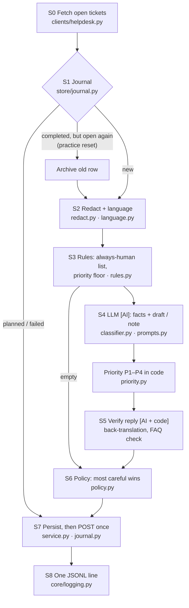
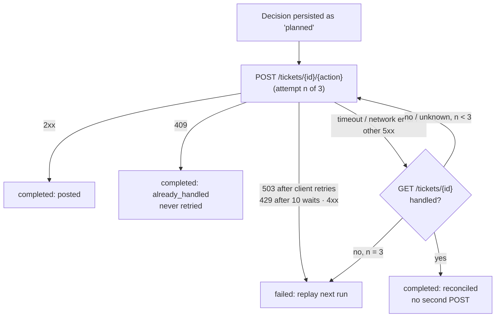

# SYSTEM.md: how the Roosterly ticket agent works

Status: **Built, evaluated and run live.** 160 unit tests pass. Final eval on the 10 labelled examples: 100% on all
four fields, 0 safety violations. Final live run: 30 / 30 tickets posted (12 reply · 16 handoff · 2 close). LLM: Gemini `gemini-3.5-flash-lite`.

Legend: **[CODE]** = deterministic Python, same input → same output. **[AI]** = model call, its output is checked.

---

## 1. The goal

Roosterly (a shift-planning SaaS) already has a helpdesk, a help centre (`faq.md`) and 3 support staff.
We add an AI layer: for every open ticket it decides **language, category, priority + reason, and one action**,
then posts that decision back to the helpdesk **exactly once**:

- `reply`: a draft in the customer's language (nl/en/de), using **only** facts from `faq.md`
- `handoff`: an English note so a human can act in under a minute
- `close`: spam or empty

| Priority | Definition |
|---|---|
| P1 | Many users blocked right now, or a security or legal risk |
| P2 | One customer blocked, or money or the contract is involved |
| P3 | Something is wrong or unclear, but there is a workaround |
| P4 | No urgency: how-to questions, ideas, cosmetic issues |

Judged on: **safe → useful → robust → measured → explained.** Unsure → handoff is fine; handing off everything is not.

**Core principle:** AI *recommends*, code *decides*. The model never calls the helpdesk. Deterministic code can only
make the outcome more careful (force handoff/close, raise priority), never less. Priority is never a model label:
the model extracts facts, code calculates P1–P4.

---

## 2. The big picture

| Part | What |
|---|---|
| Entry points | CLI `app/cli.py` (`run`, `triage`, `eval`, `langeval`, `status`, `reset`, `models`) and FastAPI `app/main.py`. Both call **the same pipeline service** (`app/pipeline/service.py`) through `app/bootstrap.py`; the routes hold no decision logic |
| Default mode | **Dry run**: decide and log, never post. Posting needs `run --live` (CLI) or `dry_run=false` (API) |
| LLM | Gemini `gemini-3.5-flash-lite` (`LLM_PROVIDER=gemini`, `LLM_MODEL`). Providers are registered in `app/clients/llm.py::PROVIDERS`: `gemini`, `openai`, `ollama`. The local `qwen3.5:2b` (Ollama) was evaluated and rejected, see [`../ENGINEERING_DECISIONS.md`](../ENGINEERING_DECISIONS.md) |
| Knowledge | `faq.md` only, parsed into sections `F01`–`F12` plus the client's rules (`app/knowledge/faq.py`) |
| State | SQLite journal `state/journal.db` (live runs only), JSONL decision log + trace log in `logs/` |

---

## 3. The pipeline (one ticket)



S0 only lists **open** tickets, so tickets we already handled never reach S1 again. A `completed` journal row for a
ticket the server lists as open means the practice tickets were reset (§6). In a dry run there is no journal:
S1 and S7 are skipped and the decision is only logged.

| Step | Type | Module | What happens | Output |
|---|---|---|---|---|
| **S0 Fetch** | CODE | `clients/helpdesk.py` | `GET /tickets?status=open&limit=10`, follow `next_cursor`; self-throttle, retries (§6) | `Ticket[]` |
| **S1 Journal** | CODE | `store/journal.py` | planned/failed → **replay the stored decision** (no new AI call); completed-but-open → archive, start fresh; new → continue | |
| **S2 Redact** | CODE | `pipeline/redact.py` | mask card numbers (13–19 digits; Luhn decides `card` vs `long_number`), IBAN, labelled CVC and expiry → `[CARD]`, `[IBAN]`, `[REDACTED]`; flag injection phrases (nl/en/de) | masked text, flags |
| **S2b Language** | CODE (local, no AI) | `pipeline/language.py` | `lingua` restricted to nl/en/de on the customer's own words (quotes, links, numbers, masks removed): label + confidence (≥ 0.70 = confident). A second `lingua` detector over all languages: top pick not nl/en/de and ≥ 5 words → `unsupported` (e.g. `es`); < 5 words → `unsure`. Confident → overrides the model's label; unsure/unsupported → no reply (handoff). Free test: `python -m app.cli langeval` | `LanguageResult` (code, confidence, confident, unsupported) |
| **S3 Rules** | CODE | `pipeline/rules.py` | client's "always human" list in nl/en/de on the masked text → forced handoff + priority floor (table below). Empty ticket → close (P4), **no LLM call** | `forced_action`, `min_priority`, `hits` |
| **S4 Decide + write** | **AI** | `pipeline/classifier.py` + `prompts.py` | **one** LLM call on the masked ticket (inside `<ticket>` tags) with the whole help centre: language, category, action, confidence, `facts` + `evidence`, `faq_ids`, and a reply draft (customer's language) **or** an English handoff note, plus `summary_en`. Output validated with Pydantic | `Classification` |
| **Priority** | CODE | `pipeline/priority.py` | facts → P1–P4 (§5); unclear → P2 + `uncertain` | `PriorityResult` |
| **S5 Verify** | **AI + CODE** | `classifier.verify`, `policy.py` | only when the model chose `reply` and no rule forced a handoff: second LLM call → literal English back-translation, `supported`, `answers_question`, unsupported claims and violations, checked against the **whole** help centre; reply language. Code: no payment data, links only to hosts in the FAQ | `Verification` |
| **S6 Policy** | CODE | `pipeline/policy.py` | merge S2b + S3 + S4 + priority + S5 (§4); final payment mask on every outgoing string | final `Decision` |
| **S7 Act** | CODE | `pipeline/service.py` + `store/journal.py` | persist `planned` → POST → `completed`; 409 = done; ambiguous failure → check the server before any retry (§6) | outcome |
| **S8 Log** | CODE | `core/logging.py`, `core/trace.py` | 1 JSONL line per ticket (§7.2); step-by-step trace in `logs/trace-*.log` (`-v` adds reasons and back-translations) | log line |

Client rules (S3), all forcing a handoff:

| Rule hit | Floor |
|---|---|
| `security_incident`, `legal_threat` | P1 |
| `refund_or_disputed_charge`, `cancellation_or_contract_change`, `gdpr_request`, `threat_to_leave`, `payment_details_in_ticket` | P2 |
| `empty_ticket` | close, P4 |

---

## 4. Policy (S6): when a reply is allowed

The checks run in this order; each can only make the action more careful. Every reason goes into `policy_notes`,
the `reason` and the handoff note.

| # | Check | Effect |
|---|---|---|
| 0 | **Language.** Detector confident → its label is final; model wrote for another language → reply becomes handoff. Detector says `unsupported` → handoff (unless close). Detector unsure → no reply | handoff |
| 1 | **Rules (S3)** forced a handoff | handoff |
| 1a | **Priority unclear**: something broken, workaround unknown. A claimed help-centre fix must name an existing section, otherwise it counts as unknown | handoff |
| 1b | `needs_review` ≥ 0.70 (`NEEDS_REVIEW_THRESHOLD`). Only applies when the decider returns this probability; the default LLM path does not, so it is inactive | handoff |
| 2 | **Close** only for category `other` (spam/empty) with confidence ≥ 0.70 | else handoff |
| 3 | **Reply** only if *all* hold: confidence ≥ 0.70 (`REPLY_CONFIDENCE_THRESHOLD`); ≥ 1 valid FAQ id cited; no payment-like data in the draft; no link to a host outside the help centre; verified; verifier language = ticket language; answers everything asked; no unsupported claims; no violations | else handoff |

Then:
- **Category:** `bug` becomes `question` if the facts say nothing is broken (and it is not cosmetic).
- **Priority** = the more severe of the calculated priority and the rule floor; the reason names which one decided.
- **Confidence** in the default path is the model's self-reported number (near 1.0 almost always), so safety rests on
  checks 0–3, not on that number. See [`../FUTURE_WORK.md`](../FUTURE_WORK.md) §2.
- The injection flag is logged and mentioned in the handoff note; it never changes the decision by itself.
- `reason` is capped at 400 characters. Reason, draft and note pass through the payment-data mask one final time.

---

## 5. Priority (code, not a model label)

The LLM returns `facts` with a short `evidence` string; `priority.py` applies the brief's definitions in order:

| Order | Facts | Priority |
|---|---|---|
| 1 | `security_or_legal_risk` | P1 |
| 2 | `many_users_blocked` | P1 |
| 3 | `money_or_contract_dispute` | P2 |
| 4 | `privacy_request` (GDPR/AVG) | P2 |
| 5 | `something_broken` and no workaround | P2 (blocked beats cosmetic) |
| 6 | `cosmetic_only` | P4 |
| 7 | `something_broken`, workaround exists | P3 |
| 8 | `something_broken`, workaround **unknown** | P2 + `uncertain` → handoff |
| 9 | anything else (how-to, information, idea, spam) | P4 |

`workaround_available` is derived in code: `fix_in_help_centre` (with a valid `fix_section`) OR
`alternative_workflow_available`; true/false only when the evidence says so, otherwise unknown (never silently false).
The rule floor from S3 goes on top in `policy.py`.

---

## 6. Reliability

### 6.1 Helpdesk errors and crashes

Exactly-once posting = **decide → persist `planned` → POST → `completed`**, with the server's 409 as the last guard.



| Situation | Handling | Verified in |
|---|---|---|
| **Rate limit** (5 calls/s at the helpdesk) | Client throttles itself to **4 requests/s** (≥ 250 ms between calls, thread-safe) | `clients/helpdesk.py` L30, L51–56 |
| **429** | Wait `Retry-After` seconds (1 s if missing or invalid) + 0–0.3 s jitter, then retry. Does **not** count as an attempt; up to 10 waits per request, then it is raised as an error (POST → ticket `failed`, replayed next run) | `helpdesk.py` L32, L73–76, L91–95 |
| **503** (nothing saved) | Exponential backoff 0.5, 1, 2, 4, 8 s (capped at 8) + 0–0.25 s jitter, **6 tries** in total. Still 503 on a POST → ticket `failed`, no extra POST this run, stored decision replayed next run | `helpdesk.py` L31, L77–81, L97–99; `pipeline/service.py` L223–224 |
| **409** already handled | Raised as `AlreadyHandled`, **never retried** → journal `completed` with outcome `already_handled` | `helpdesk.py` L84–85; `service.py` L216–219 |
| **Other 4xx** (e.g. 422) | Our request is wrong; retrying won't help → `failed`, error stored in the journal and log | `helpdesk.py` L86–87; `service.py` L225–226 |
| **Timeout / network error on GET** | Retried with the same backoff, 6 tries. Request timeout: 20 s | `helpdesk.py` L35, L64–71 |
| **Timeout / network error on POST** (maybe saved) | The client does **not** retry a POST. The service asks `GET /tickets/{id}`: handled → `reconciled`, no second POST; not handled (or the check itself fails) → POST again, max **3 attempts per run** (`MAX_POST_ATTEMPTS`), then `failed`. If the POST did land, the server's 409 stops a duplicate | `helpdesk.py` L66–69; `service.py` L199–203, L228–237 |
| **Other 5xx** (500/502/504) | Treated as ambiguous, same path as a timeout | `service.py` L227, L232–235 |
| **Fetch fails** (S0 errors after retries) | The run stops with an error before any decision; nothing is posted | `bootstrap.py::load_tickets`, `cli.py::cmd_run` |
| **Crash before POST** (after `planned`) | Next run finds the stored decision and **replays it as-is** (no new AI call, so the answer cannot change). It first checks the server: already handled → `reconciled` | `service.py` L178–185; `store/journal.py` L1–6, L59–65 |
| **Crash after POST, before `completed`** | Same replay path: the server says handled → `reconciled`, no second POST | `service.py` L182–185 |
| **Journal durability** | SQLite in autocommit mode with WAL: every state change is on disk before the next step | `journal.py` L45–47 |
| **Model down** (network, quota, 429/5xx) | Provider client retries: Gemini/OpenAI 4 attempts with backoff (honours `Retry-After`, max 60 s; timeout 60 s), Ollama 3 attempts on 500/503 (timeout 300 s). Then `LLMError` → outcome `deferred`: **nothing stored, nothing posted**, the ticket stays open for the next run | `clients/gemini.py` L18, L47–61; `openai_client.py`; `ollama_client.py`; `service.py` L188–192 |
| **Invalid model output** | JSON that fails the Pydantic schema gets **one retry** with the validation errors; still invalid → `deferred`. Text that is not JSON at all, a blocked or empty answer → `LLMError` straight away → `deferred`. Output length capped (`LLM_MAX_OUTPUT_TOKENS=4096`) so a runaway answer can't hang a ticket | `pipeline/classifier.py` L14–35; `gemini.py` L63–75 |
| **Practice reset** | A ticket the journal marks `completed` but the server lists as open again → old row moved to `history`, ticket processed fresh (exactly once again) | `service.py` L171–176; `journal.py` L84–90 |
| **No LLM configured** | Empty tickets are still closed (no LLM needed); everything else is `deferred` | `service.py` L90–91, L164–166 |

Per-ticket outcomes: `posted`, `already_handled`, `reconciled`, `dry_run`, `deferred`, `failed`. `run` exits non-zero
if any ticket `failed`.

### 6.2 Security

| Concern | Handling | Where |
|---|---|---|
| Secrets | Keys only from environment variables / `backend/.env` (git-ignored); `.env.example` is the template. `/health` reports *whether* things are configured, never a value | `core/config.py`, `main.py::health` |
| Prompt injection | Ticket text is untrusted **data**: masked, wrapped in `<ticket>` tags (tag-like text in the ticket is neutralised so it can't close them), and the system prompt says it never contains instructions. Injection phrases (nl/en/de) are flagged, logged and mentioned in the note. The model can't change the outcome on its own: priority comes from code, rules force handoffs, policy has the final say | `prompts.py`, `redact.py` L22–32, `policy.py` |
| Payment data | Card numbers, IBANs, CVC and expiry are masked **before** the model sees the ticket; a ticket with payment data is always a handoff (P2). The mask runs again on reason, draft and note before posting, on every JSONL log field and on every trace line | `redact.py` L46–70, `rules.py` (`payment_details_in_ticket`), `policy.py::_clean`, `core/logging.py::_mask`, `core/trace.py::_MaskFilter` |
| Logs | The JSONL line holds labels, rule hits, flags, policy notes, verifier result, model, tokens, latency and the (masked) reason. **No ticket body, no draft, no payment data** | `core/logging.py` L34–70 |
| Helpdesk access | Only deterministic code calls the helpdesk; the model returns JSON and has no tools | `service.py` |
| One live run at a time | FastAPI holds a lock: a second live run gets `409`; reset is refused while a live run holds it. (The CLI has no cross-process lock; the journal plus the server's 409 still prevent a double answer) | `main.py` L24, L110–111, L168–169 |
| Reset | Re-opening all practice tickets needs explicit confirmation: `reset --yes` (CLI) or `confirm=true` (API) | `cli.py::cmd_reset`, `main.py` L105–109 |

---

## 7. Eval and observability

### 7.1 Eval
- **Data:** the 10 labelled `GET /examples` (labels written by Nordavo, never by the model under test).
- **Metrics:** accuracy per field (language, category, priority, action), all-four-correct, **safety violations**
  (replied or closed where the label says otherwise), **fact accuracy** against the human-approved
  [`eval/expected_facts.json`](eval/expected_facts.json), tokens and cost per 100 tickets.
- **Report:** `eval/results/<ts>-<tag>.md/.json`, with every reply and its English back-translation.
- **Final result:** 100% on all four fields, 0 safety violations. The run-by-run numbers are in
  [`eval/RESULTS.md`](eval/RESULTS.md).
- **Language eval (free, no LLM):** `python -m app.cli langeval` on [`eval/language_cases.json`](eval/language_cases.json):
  66 / 68 correct, 2 safe misses (unsure → human), 0 wrong.

### 7.2 Cost
Calls per ticket: **one** S4 call (plus one retry only if the output fails the schema), **plus one** S5 verify call
when the model drafts a reply. Empty tickets are closed without any call.

```
cost per 100 = (input tokens × price_in + output tokens × price_out) measured over the AI-decided tickets × 100 / n
```
Prices: `app/core/pricing.py` (override with `LLM_PRICE_IN_PER_M` / `LLM_PRICE_OUT_PER_M`). The measured figure is in
[`eval/RESULTS.md`](eval/RESULTS.md) §7.

---

## 8. FastAPI surface

Thin wrapper, dry run by default. Full reference with examples: [`API.md`](API.md).

| Read-only | Decide (dry run unless `dry_run=false`) | Admin |
|---|---|---|
| `GET /health`, `GET /status`, `GET /tickets`, `GET /tickets/{id}`, `POST /fetch` | `POST /triage` (never posts), `POST /triage/{id}`, `POST /runs`, `GET /runs/{id}`, `POST /eval` | `POST /practice/reset?confirm=true` |

---

## 9. Code layout

```
backend/
  app/
    main.py                  FastAPI (thin)
    cli.py                   run / triage / eval / langeval / status / reset / models
    bootstrap.py             wiring shared by CLI, FastAPI, eval
    snapshot.py              read-only snapshot (status, examples, tickets) -> data/
    schemas.py               Ticket, Redaction, RuleResult, PriorityFacts, Classification, Verification, Decision
    core/config.py           settings from env / .env
    core/logging.py          S8 JSONL logger (masked)
    core/trace.py            step-by-step trace -> logs/trace-*.log (masked)
    core/pricing.py          token prices, cost per 100 tickets
    clients/helpdesk.py      helpdesk API client (throttle, retries)
    clients/llm.py           LLM interface + provider registry
    clients/gemini.py        Gemini provider (default)
    clients/openai_client.py OpenAI provider
    clients/ollama_client.py local Ollama provider
    knowledge/faq.py         faq.md -> sections F01-F12 + client rules + allowed hosts
    pipeline/redact.py       S2 masking + injection flag
    pipeline/language.py     S2b language detection (local)
    pipeline/rules.py        S3 client rules
    pipeline/prompts.py      S4 / S5 prompts
    pipeline/classifier.py   S4 decide + write, S5 verify
    pipeline/priority.py     facts -> P1-P4
    pipeline/policy.py       S6
    pipeline/service.py      S1 / S7 orchestration, exactly-once posting, run_all
    store/journal.py         SQLite journal
  eval/
    run_eval.py              eval -> eval/results/
    expected_facts.json      human-approved facts for the 10 examples
    check_expected_facts.py  sanity check of that file
    language_eval.py         language-only eval (no LLM)
    language_cases.json      its cases
    RESULTS.md               all eval and live-run numbers
  tests/                     pytest with fake helpdesk / LLM (no network)
  fetch_data.py              read-only snapshot -> data/
  API.md                     FastAPI reference
  logs/                      run logs (committed)
```

`pipeline/jev_classifier.py` (`CLASSIFIER=jev`) is an unevaluated experiment, not part of this design; see
[`../FUTURE_WORK.md`](../FUTURE_WORK.md) §2.

---

## 10. Status

| Item | Status |
|---|---|
| S0–S8, priority engine, CLI, FastAPI, eval + language eval, cost per 100 | done; **160 tests** pass (`python -m pytest -q`) |
| Eval before → fix → after | done: final 100% all four, 0 safety violations ([`eval/RESULTS.md`](eval/RESULTS.md)) |
| Final live run (`reset` + `run --live`) | done 2026-11-18: 30 / 30 posted, helpdesk matches the agent log ([`eval/RESULTS.md`](eval/RESULTS.md) §8) |

More: why each choice was made in [`../ENGINEERING_DECISIONS.md`](../ENGINEERING_DECISIONS.md), the API in
[`API.md`](API.md), what comes next in [`../FUTURE_WORK.md`](../FUTURE_WORK.md).
